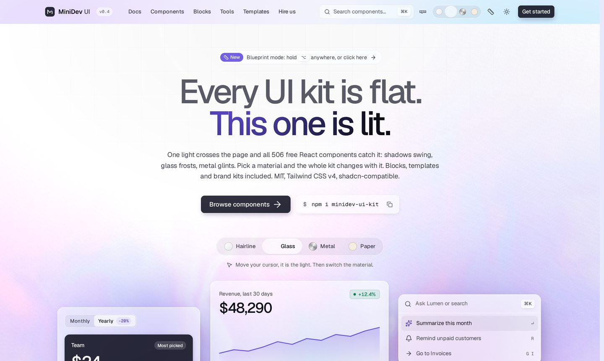

<div align="center">

# MiniDev UI

**548 free React components, blocks and motion pieces for real product screens. Built so AI coding agents get them right on the first try.**<br/>
Tailwind CSS v4 · Base UI · Motion · shadcn-compatible · MIT

[Website](https://ui.minidev.pro) · [Docs](https://ui.minidev.pro/docs) · [Components](https://ui.minidev.pro/components) · [Blocks](https://ui.minidev.pro/blocks) · [Templates](https://ui.minidev.pro/templates) · [For AI agents](https://ui.minidev.pro/docs/ai) · [llms.txt](https://ui.minidev.pro/llms.txt)

[](https://www.npmjs.com/package/minidev-ui-kit)
[](./LICENSE)
[](https://ui.minidev.pro/docs/installation)
[](https://ui.minidev.pro/llms.txt)

<picture>
  <source media="(prefers-color-scheme: dark)" srcset=".github/assets/hero-dark.jpg">
  
</picture>

</div>

## Quick start

Pick one route. Every component page on the site shows its own command.

**shadcn CLI** (one component, source lands in `components/ui/`):

```bash
npx shadcn@latest add @minidev/multi-select
curl -o app/minidev.css https://ui.minidev.pro/r/styles.css   # tokens, once per project
```

Then `@import "./minidev.css";` after `@import "tailwindcss";` in your global CSS, and delete the `:root`, `.dark` and `@theme inline` blocks `shadcn init` wrote (they override the tokens and turn the accent gray). MiniDev UI is in the [shadcn registry directory](https://ui.shadcn.com/docs/directory), so `@minidev/` needs no setup. The long form `npx shadcn@latest add https://ui.minidev.pro/r/multi-select.json` also works.

**npm** (the whole kit):

```bash
npm i minidev-ui-kit @base-ui/react class-variance-authority clsx tailwind-merge lucide-react motion
```

```css
/* app/globals.css */
@import "tailwindcss";
@import "minidev-ui-kit/styles.css";
@source "../node_modules/minidev-ui-kit";
```

```tsx
import { MultiSelect } from "minidev-ui-kit/ui/multi-select"
```

With Next.js, add `transpilePackages: ["minidev-ui-kit"]` to `next.config`.

**Copy the file.** Every docs page has a Code tab with the full source, and `https://ui.minidev.pro/r/<name>.json` carries the same source plus its npm and registry dependencies. Paste it into `components/ui/<name>.tsx`, add the `cn` helper and the tokens stylesheet above. It is your code from then on.

Framework guides: [Next.js](https://ui.minidev.pro/docs/installation/nextjs) · [Vite](https://ui.minidev.pro/docs/installation/vite) · [React Router](https://ui.minidev.pro/docs/installation/react-router) · [Astro](https://ui.minidev.pro/docs/installation/astro) · [TanStack Start](https://ui.minidev.pro/docs/installation/tanstack-start)

## For AI agents

MiniDev UI is written to be read by machines as much as by people. One line in your prompt is enough:

```text
Use MiniDev UI for the interface. Read https://ui.minidev.pro/llms.txt first, then https://ui.minidev.pro/docs/<name>.md for each component you use, and install with npx shadcn@latest add @minidev/<name>.
```

**MCP server.** Six tools (`search_components`, `list_components`, `get_component`, `get_example`, `get_design_rules`, `get_install_instructions`), hosted at `https://ui.minidev.pro/mcp` (no install, no API key). Setup for Cursor, VS Code, Windsurf and Codex is in [mcp/README.md](./mcp/README.md).

```bash
claude mcp add --transport http minidev-ui https://ui.minidev.pro/mcp
```

**Docs an agent can fetch:**

| URL | What it holds |
|---|---|
| [`/llms.txt`](https://ui.minidev.pro/llms.txt) | Install routes, house rules and a one-line index of every component. |
| [`/llms-full.txt`](https://ui.minidev.pro/llms-full.txt) | Every component in full: purpose, when to use, install, import, props, examples. |
| [`/docs/<name>.md`](https://ui.minidev.pro/docs/button.md) | One component's docs as Markdown. Every docs page also has a "Copy page" button. |
| [`/components.json`](https://ui.minidev.pro/components.json) | Machine catalog: name, category, install, imports, props, deps, related. |
| [`/r/<name>.json`](https://ui.minidev.pro/r/button.json) | The shadcn registry item with the exact source. Index at [`/r/registry.json`](https://ui.minidev.pro/r/registry.json). |

**Rules files** so the agent writes code the way the kit does:

| File | For |
|---|---|
| [`AGENTS.md`](https://ui.minidev.pro/AGENTS.md) | Codex, Windsurf, Copilot, Jules, Zed and anything that reads AGENTS.md |
| [`minidev-ui.mdc`](https://ui.minidev.pro/rules/minidev-ui.mdc) | Cursor project rules |
| [`SKILL.md`](https://ui.minidev.pro/skill/minidev-ui/SKILL.md) | Claude Code skill |

```bash
curl -fsSL https://ui.minidev.pro/AGENTS.md >> AGENTS.md
```

The npm package ships `llms.txt` and `DESIGN.md` too, so an agent can read them offline in `node_modules/minidev-ui-kit/`. Why agents get it right: every component is one file with named PascalCase exports (`chat-thread` exports `ChatThread`), typed props with JSDoc, no default exports, and the same semantic tokens everywhere. Full setup per tool: [ui.minidev.pro/docs/ai](https://ui.minidev.pro/docs/ai).

## Example

```bash
npx shadcn@latest add @minidev/page-header @minidev/kpi-row @minidev/chart-card @minidev/area-chart @minidev/button
```

```tsx
import { AreaChart } from "@/components/ui/area-chart"
import { Button } from "@/components/ui/button"
import { ChartCard } from "@/components/ui/chart-card"
import { KpiRow } from "@/components/ui/kpi-row"
import { PageHeader } from "@/components/ui/page-header"

export default function Dashboard() {
  return (
    <main className="mx-auto max-w-6xl space-y-6 p-6">
      <PageHeader title="Overview" description="Last 30 days" actions={<Button size="sm">Export</Button>} />
      <KpiRow
        items={[
          { label: "MRR", value: "$48.2k", delta: 8 },
          { label: "Active accounts", value: "1,204", delta: 3 },
          { label: "Churn", value: "1.1%", delta: -0.3, invert: true },
        ]}
      />
      <ChartCard title="Revenue" description="Last 8 weeks">
        <AreaChart data={[18, 22, 27, 31, 36, 41, 45, 52]} label="Weekly revenue, $k" className="h-48 w-full" />
      </ChartCard>
    </main>
  )
}
```

## The four signatures

What other kits do not ship, and what an AI cannot produce on its own:

- **Light.** One light source crosses the page. Render `<LightProvider />` once and it follows the pointer (a slow drift on phones); every shadow falls away from it and every raised edge catches it. Without it, shadows fall from a fixed light.
- **Materials.** Four finishes from one token set: `hairline` (quiet default), `glass`, `metal`, `paper`. Set `data-material="metal"` on `<html>` or on any element; materials nest. Same markup, four looks, in light and dark.
- **Blueprint.** Every value is a token and every size sits on a 2px grid. On the site, hold Option (Alt) and hover anything to see its box, padding, gaps, radius, type and the exact token classes. Off-grid values get flagged.
- **Physics.** Springs, not durations, from five shared presets. Digits roll, thumbs glide, a button stretches into its panel. Nothing animates on page load in product UI, and everything is instant with reduced motion.

The rules behind them: [DESIGN.md](./DESIGN.md) and [docs/VISION.md](./docs/VISION.md).

## What's inside

| Kind | Count | Path |
|---|---|---|
| Components | 397 | `src/registry/ui` → `minidev-ui-kit/ui/<name>` |
| Blocks (full sections and pages) | 43 | `src/registry/blocks` → `minidev-ui-kit/blocks/<name>` |
| Motion pieces | 108 | `src/registry/premium` → `minidev-ui-kit/premium/<name>` |

Every one renders live on its docs page with a typed API table generated from the source. Built on [Base UI](https://base-ui.com) for focus, keyboard and ARIA.

| Category | Examples |
|---|---|
| [Forms](https://ui.minidev.pro/components/forms) | multi select, combobox, date range picker, OTP, masked input, password strength, signature pad |
| [Data tables](https://ui.minidev.pro/components/data-tables) | sortable data table, row selection, pagination, column filters |
| [Charts](https://ui.minidev.pro/components/charts) | area, bar, line, pie, donut, radial, treemap, sankey, funnel, Gantt, sparklines |
| [Dashboard](https://ui.minidev.pro/components/dashboard) | event calendar, KPI rows, activity feed, onboarding checklist |
| [Billing](https://ui.minidev.pro/components/billing) | pricing tables, credit card input, plan cards, invoices, usage meters |
| [Settings](https://ui.minidev.pro/components/settings) | profile, team, API keys, notifications, danger zone |
| [AI chat](https://ui.minidev.pro/components/ai-chat) | chat thread, prompt input, streaming message, model picker |
| [Navigation](https://ui.minidev.pro/components/navigation) | sidebar, command palette, tabs, breadcrumbs, stepper |
| [Feedback](https://ui.minidev.pro/components/feedback) | toast, notification center, empty states, skeletons |
| [Animation](https://ui.minidev.pro/components/animation) | aurora, globe, particles, tilt card, shine border, terminal, text effects |
| [Media](https://ui.minidev.pro/components/media) and [dev tools](https://ui.minidev.pro/components/developer-tools) | image cropper, gallery, file tree, code block, audio player |
| [Marketing](https://ui.minidev.pro/components/marketing) | heroes, feature grids, bento grid, testimonials, FAQ, CTA |

Plus [20 categories](https://ui.minidev.pro/components) in all, [15 block types](https://ui.minidev.pro/blocks), [8 full templates](https://ui.minidev.pro/templates), [19 free tools](https://ui.minidev.pro/tools) (shadcn theme generator, SVG to JSX, CSS to Tailwind, contrast checker) and [40+ guides](https://ui.minidev.pro/guides).

## Run the site locally

```bash
npm install
npm run dev          # builds the registry, then starts Next.js on localhost:3000
```

Analytics are off unless you set env vars on your host. See `.env.example`.

```
src/registry/ui           components
src/registry/blocks       full-page compositions
src/registry/premium      motion pieces (free, like everything else)
src/registry/examples     live examples shown on docs pages
src/styles/minidev.css    tokens, light, materials, motion
tools/build-registry.mjs  registry, llms.txt, llms-full.txt and components.json generator
mcp/                      the MCP server (core.mjs; stdio in server.mjs, HTTP at src/app/mcp)
DESIGN.md, docs/VISION.md the design rules
```

## Contributing

Bug reports, component requests and pull requests are welcome. [CONTRIBUTING.md](./CONTRIBUTING.md) shows how to add a component that passes the laws. Security issues: see [SECURITY.md](./SECURITY.md).

## License

[MIT](./LICENSE). Free for personal and commercial projects, no attribution required.

---

Made by [MiniDev](https://minidev.pro), a studio that builds MVPs, apps and websites with this kit. Need the product, not just the parts? [Talk to us](https://ui.minidev.pro/studio).
